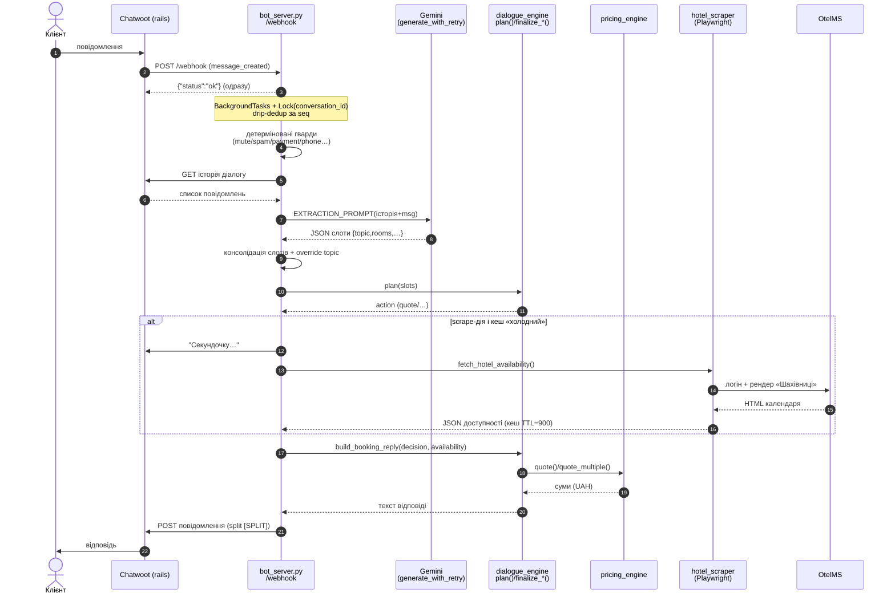
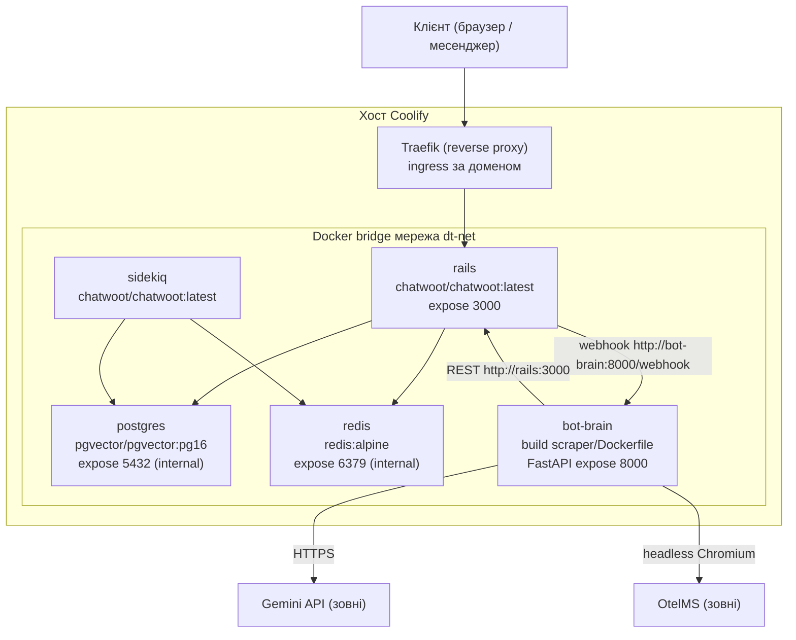

# Підрозділ 3.1 — Архітектура програмного забезпечення

> Технічна фактура витягнута ВИКЛЮЧНО з реального коду репозиторію `DM` (гілка
> `main`). Секрети замасковано (`***`). Кожне нетривіальне твердження супроводжене
> посиланням `файл:рядок`. Академічний текст за цією фактурою пише інша модель.

---

## 3.1.1 Архітектурний стиль і поділ на шари

Застосунок реалізує архітектурний принцип **«LLM витягує — Python вирішує»**
(`CLAUDE.md` §3). Велика мовна модель (Gemini) зведена до однієї ролі —
**екстракції/класифікації**: вона повертає структурований JSON (слоти), але
НІКОЛИ не рахує ціну, дату чи день тижня і не пише клієнтський текст. Уся грошова,
календарна та форматна логіка — детермінований Python, покритий unit-тестами.

Код поділено на **чисті** (тільки stdlib, тестовані без важких залежностей) і
**сервісні** (FastAPI / мережа / браузер) модулі — межа задекларована в
`CLAUDE.md` §5 і підтверджується імпортами: `pricing_engine.py` і `bot_logic.py`
не імпортують ні FastAPI, ні `google-genai`, ні Playwright.

| Шар | Роль | Файл(и) | Залежності |
|---|---|---|---|
| **A. Транспорт / оркестрація** | HTTP-webhook, черга фонових задач, послідовність кроків обробки, Chatwoot I/O, кеш доступності, in-memory стан діалогу | `scraper/bot_server.py` | FastAPI, `requests`, `google-genai`, asyncio |
| **B. Екстракція (LLM)** | Один prompt-шаблон + виклик Gemini з бекофом; повертає JSON-слоти | `scraper/bot_server.py:158-251` (`EXTRACTION_PROMPT`), `:139-153` (`generate_with_retry`) | `google-genai` |
| **C. Детерміноване рішення** | `plan()` — вибір дії (quote / quote_all / explore / nearest / reply); побудова клієнтських відповідей; гейт доступності | `scraper/dialogue_engine.py` | тільки stdlib + `pricing_engine` |
| **D. Цінова математика** | Клас `PricingEngine`: ночі, будні/вихідні, дитячі/додаткові місця, мульти-кімната, off-season, УБД, харчування | `scraper/pricing_engine.py`, конфіг `scraper/pricing.json` | тільки stdlib |
| **E. Чисті хелпери / гейти** | Детектори spam/barter/phone/payment/large-group, фільтр доступності, `[SPLIT]`, greeting, нормалізація слотів | `scraper/bot_logic.py` | тільки stdlib |
| **F. База знань (шаблони)** | Усі клієнтські тексти (FAQ, ціни, редиректи, closes) | `scraper/templates.py` | — |
| **G. Скрапер доступності** | Playwright-логін в OtelMS, рендер «Шахівниці», парсинг у JSON доступності | `scraper/hotel_scraper.py` | Playwright, BeautifulSoup |

**Важлива архітектурна деталь:** сам бот (`bot-brain`) **не має власної бази
даних і власної черги**. Уся пам'ять діалогу — це in-memory `dict`/`set` у
процесі FastAPI: `AVAILABILITY_CACHE` (`bot_server.py:28`), `_conv_locks`,
`_conv_seq`, `_slot_memory`, `_greeted`, `_pending_window`, `_pending_split`,
`_meals_memory`, `_no_dates_mode`, `_cooldowns` (`bot_server.py:312-320`).
PostgreSQL і Redis у стеку належать **Chatwoot**, а не боту (див. §3.1.6).

---

## 3.1.2 Логічні компоненти та їх відповідальність

### A. `bot_server.py` — ядро транспорту й оркестрації
- **ASGI-застосунок:** `app = FastAPI()` (`bot_server.py:26`).
- **Єдиний ендпойнт:** `@app.post("/webhook")` (`bot_server.py:894`) — приймає
  вебхуки Chatwoot, кладе обробку у `BackgroundTasks` (`bot_server.py:918`) і
  миттєво відповідає `{"status": "ok"}`.
- **Оркестратор одного повідомлення:** `process_incoming_message` (`:342`) →
  `_handle_incoming` (`:355`): виконує детерміновані гварди, виклик LLM, роутинг,
  доставку.
- **Клієнти зовнішніх сервісів:**
  - Chatwoot REST: `send_chatwoot_message` (`:32`), `get_chatwoot_history` (`:52`),
    `get_conversation_labels` (`:71`), `add_conversation_label` (`:83`).
  - Gemini: `ai_client = genai.Client(...)` (`:23`), модель
    `MODEL_NAME = 'gemini-2.5-flash-lite'` (`:24`), виклик через
    `generate_with_retry` (`:139`).
  - Скрапер (через кеш): `get_hotel_data_cached` (`:99`), `peek_cached_availability` (`:118`).

### B. Екстракційний шар (LLM)
- `EXTRACTION_PROMPT` (`bot_server.py:158-251`) — інструкція, що повертати
  **виключно JSON** структури `{topic, rooms[], faq_template, meals}`;
  плейсхолдери `%%TODAY%%`, `%%HISTORY%%`, `%%MESSAGE%%` підставляються у
  `_handle_incoming` (`:450-453`).
- `generate_with_retry` (`:139-153`) — виклик `ai_client.aio.models.generate_content`
  з експоненційним бекофом (2s, 4s) лише на **транзієнтних** помилках
  (`_is_retryable_llm_error`, `:131`: 503/429/timeout/overloaded…).
- Парсинг відповіді — `dialogue_engine.parse_slots` (`dialogue_engine.py:60`), із
  безпечним фолбеком на `greeting` при поганому JSON.

### C. `dialogue_engine.py` — детермінований конструктор рішення й відповіді
- `plan(slots)` (`dialogue_engine.py:618`) — обирає дію; scrape-дії:
  `quote / quote_all / explore / nearest` (набір `_SCRAPE_ACTIONS`,
  `bot_server.py:286`), інакше повертає готову `reply`.
- Побудова текстів: `finalize_quote` (`:811`), `finalize_quote_all` (`:937`),
  `propose_windows` (`:480`), `nearest_reply` (`:1147`), `finalize_meals` (`:1097`),
  `bed_availability_reply` (`:1129`). Диспетчер над ними — `build_booking_reply`
  (`bot_server.py:289`).
- **Гейт доступності** всередині `finalize_quote` — ніколи не котирує проданий
  номер (`CLAUDE.md` §4 п.1b).
- Тримає екземпляр цінового рушія: `ENGINE = pricing_engine.PricingEngine()`
  (`dialogue_engine.py:28`).

### D. `pricing_engine.py` — цінова математика
- Клас `PricingEngine` (`pricing_engine.py:233`), метод `quote(...)` (`:308`),
  `quote_multiple(...)` (`:379`). Конфіг цін/правил вантажиться з
  `pricing.json` (`_DEFAULT_PRICING_PATH`, `:79`).
- Доменні типи: `Guest` (`:94`), `Quote` (`:109`), `MultiQuote` (`:119`),
  `MealQuote` (`:414`); винятки `OffSeasonError` (`:82`), `OverCapacityError` (`:86`).

### E. `bot_logic.py` — чисті гейти й хелпери
- Детектори-короткі-замикання: `is_barter` (`:179`), `is_spam` (`:161`),
  `is_payment_intent` (`:1170`), `contains_phone_number` (`:1141`),
  `is_booking_com_question` (`:336`), `is_muted` (`:1179`),
  `looks_like_large_group` (`:199`), `faq_override` (`:888`).
- Обробка доступності/тексту: `build_simplified_availability` (`:49`),
  `split_messages` (`:1191`), `prepend_greeting_if_needed` (`:1184`).

### F. `templates.py` — база знань
- Усі клієнтські рядки; сервер лише підставляє плейсхолдери
  (`route_simple_topic`, `bot_server.py:263`).

### G. `hotel_scraper.py` — скрапер OtelMS
- `fetch_hotel_availability()` (`hotel_scraper.py:19`) — Playwright Chromium
  (headless), логін на `LOGIN_URL` (`:16`), перехід на `CALENDAR_URL` (`:17`),
  очікування селектора `td[category_id]` (`:45`), забір HTML.
- `parse_detailed_availability(html)` (`:59`) — BeautifulSoup: агреговані
  лічильники (`total_available`) і статуси по фізичних кімнатах (`Available`/`Booked`).

---

## 3.1.3 Спосіб взаємодії компонентів

| Взаємодія | Механізм | Напрям | Код |
|---|---|---|---|
| Chatwoot → бот | **HTTP webhook** `POST /webhook` (подія `message_created`) | вхідний | `bot_server.py:894-925` |
| Бот → Chatwoot | **REST API** (`requests.post/get`, `api_access_token`) | вихідний | `bot_server.py:32-97` |
| Бот → Gemini | **HTTPS SDK-виклик** (`google-genai`, async) | вихідний | `bot_server.py:139-153` |
| Бот → OtelMS | **Headless-браузер** (Playwright, логін+скрейп) | вихідний | `hotel_scraper.py:19-57` |
| Транспорт → рішення | **внутрішні виклики Python** (import) | у процесі | `bot_server.py:11-14` |
| Асинхронність / паралелізм | `BackgroundTasks` + `asyncio.Lock` на конверсацію | у процесі | `bot_server.py:312-352, 918` |
| Кеш доступності | in-memory `dict` з TTL=900 c | у процесі | `bot_server.py:28-29, 99-129` |

**Ключові властивості взаємодії:**
- **Немає власної БД/черги на боці бота.** Стан — тільки процесна пам'ять
  (`bot_server.py:28, 312-320`); при рестарті `bot-brain` кеш і пам'ять діалогу
  скидаються.
- **Серіалізація за конверсацією:** на кожну `conversation_id` — свій
  `asyncio.Lock` (`_lock_for`, `:323`); у «пачці» drip-повідомлень відповідає лише
  **останнє** (`_next_seq` / `_superseded`, `:331-339`).
- **Кеш проти подвійного скрейпу:** повторний виток бере доступність з теплого
  кешу без запуску Playwright (`peek_cached_availability`, `:118`).
- **Деградація при збої LLM:** після вичерпання ретраїв — одноразове holding-повідомлення
  `ERROR_LLM_DOWN`, тег `Instagram`, 5-хвилинний «кулдаун-мовчання`
  (`COOLDOWN_TTL = 300`, `:30`, `:457-471, 367-370`).

---

## 3.1.4 Зовнішні інтеграції (хто кого викликає)

Три зовнішні системи; бот — завжди ініціатор вихідних викликів, крім **єдиного
вхідного** каналу — вебхука від Chatwoot.

| Система | Тип каналу | Ініціатор | Напрям даних |
|---|---|---|---|
| **Chatwoot** (омніканальна платформа) | (1) webhook `POST /webhook`; (2) REST API | (1) Chatwoot → бот; (2) бот → Chatwoot | вхід: нове повідомлення клієнта; вихід: текст відповіді, історія, мітки |
| **Gemini** (`gemini-2.5-flash-lite`) | HTTPS-виклик SDK `google-genai` | бот → Gemini | вхід prompt (історія+повідомлення) → вихід JSON-слоти |
| **OtelMS** («Шахівниця») | Playwright (headless Chromium) | бот → OtelMS | вихід: HTML календаря → JSON доступності |

Деталі:
- **Chatwoot вхідний (webhook):** приймається лише `event == "message_created"` з
  `message_type ∈ ("incoming", 0)`; приватні нотатки агента ігноруються
  (`bot_server.py:907-909`). Інбокс/канал не фільтрується — обслуговуються всі
  (WebWidget/API/Instagram) однаково (`bot_server.py:905-906`).
- **Chatwoot вихідний (REST):** база — `CHATWOOT_URL` (env, дефолт
  `http://rails:3000`, `:19`), автентифікація заголовком `api_access_token`
  (`CHATWOOT_TOKEN`, `:20, 35`), акаунт `CHATWOOT_ACCOUNT_ID` (`:21`).
- **Gemini:** ключ `GEMINI_API_KEY` (env, `:18`); викликається **один раз на
  повідомлення** — тільки для екстракції (`:455`).
- **OtelMS:** креденшали `OTELMS_HMS_ID` / `OTELMS_LOGIN` / `OTELMS_PASSWORD`
  (env, `hotel_scraper.py:12-14`); виклик — лише на детермінованій scrape-дії й за
  «холодного» кешу.

---

## 3.1.5 Наскрізний потік ОДНОГО запиту клієнта (основа sequence-діаграми)

Нумерація кроків для одного повідомлення клієнта, що доходить до котирування ціни
(шлях `quote`). Джерело — `bot_server.py:894-925` (webhook) і `:355-892`
(`_handle_incoming`).

1. **Клієнт → Chatwoot.** Клієнт пише в один з інбоксів Chatwoot.
2. **Chatwoot → бот (webhook).** Chatwoot шле `POST /webhook` з подією
   `message_created`. Хендлер валідовує подію/тип, дістає `content`,
   `conversation_id`, наявність вкладень (`:901-916`).
3. **Постановка у фон.** Присвоюється порядковий `seq` (`_next_seq`) і задача
   ставиться у `BackgroundTasks` → миттєва відповідь `{"status":"ok"}`
   (`:917-925`). Далі — асинхронно.
4. **Лок конверсації + dedup.** `process_incoming_message` бере `asyncio.Lock`
   на `conversation_id`; якщо надійшло новіше повідомлення — поточне
   пропускається (`_superseded`, `:348-352`).
5. **Детерміновані гварди (без LLM).** Послідовно: mute-мітка (`is_muted`) →
   503-кулдаун → barter → spam → payment → phone → Booking.com
   (`:360-409`). Будь-який спрацьований гвард завершує обробку раніше.
6. **Читання історії.** `get_chatwoot_history` (`GET` до Chatwoot) — уся стрічка
   діалогу; формуються `dialogue_history` та `client_history` (`:411-429`).
7. **Обробка «чистої подяки».** Якщо це лише «дякую» — теплий close без LLM
   (`is_pure_thanks`, `:434-447`).
8. **LLM-екстракція.** Формується prompt (підстановка `%%TODAY%%`/`%%HISTORY%%`/
   `%%MESSAGE%%`) → `generate_with_retry` → `parse_slots` → `slots`
   (`:450-456`). За збою LLM — крок деградації (`ERROR_LLM_DOWN` + тег + кулдаун,
   `:457-471`).
9. **Консолідація слотів (Python).** Нормалізація «N номерів для M гостей»,
   згортання дублікатів, злиття з `_slot_memory`, добудова дат/ночей, детекція
   «дат ще не знаю» (`:481-538`).
10. **Детерміновані override-и topic.** Large-group (20+) → `group_event`;
    інакше FAQ-абсолютний пріоритет (`faq_override`); обробка «Так» після
    квоти/вікна/спліту (`:540-606`).
11. **Роутинг.** `route_simple_topic` повертає фіксований шаблон для непінгових
    тем; інакше `reply is None` → викликається `plan(slots)`
    (`:653, 670-671`).
12. **Рішення `plan()`.** `dialogue_engine.plan` повертає `action`. Якщо це
    scrape-дія (`quote/quote_all/explore/nearest`) і повідомлення реально
    змінило бронювання (`slots_changed`) — переходимо до скрейпу; інакше
    відповідь із кешу або тиша (`:671-728`).
13. **Greeting на першому ході.** Якщо бот ще не говорив — спершу шле `GREETING`
    (`:731-733`).
14. **Скрейп доступності (за потреби).** `get_hotel_data_cached`: якщо кеш
    свіжий — бере його; інакше шле «Секундочку…», запускає
    `fetch_hotel_availability` (Playwright → OtelMS), кладе результат у кеш
    (`:99-115, 736`).
15. **Спрощення доступності.** `bot_logic.build_simplified_availability`
    перетворює сирий JSON на структуру для рушія (`:742`).
16. **Побудова відповіді (детермінована).** `build_booking_reply` → відповідна
    функція `dialogue_engine` (`finalize_quote` тощо), усередині — гейт
    доступності та `PricingEngine` для сум (`:743, dialogue_engine.py:811`).
17. **Пост-обробка тексту.** Анти-спам (не повторювати 2 останні репліки),
    примітка про тваринку, доповнення FAQ пачки, off-season-тег
    (`:754-880`).
18. **Фінальна перевірка на superseded.** Якщо під час обробки прийшло новіше
    повідомлення — відповідь придушується (`:781-783`).
19. **Доставка → Chatwoot.** `_emit` → `_deliver` → `split_messages` по
    `[SPLIT]` → `send_chatwoot_message` (`POST`), з людяною паузою 1.5 c між
    частинами (`:305-309, 799-819`).
20. **Chatwoot → клієнт.** Chatwoot розсилає відповідь у канал клієнта.

---

## 3.1.6 Топологія розгортання

Два варіанти compose: локальний (dev) і Coolify (prod). Обидва піднімають **п'ять
контейнерів**; відрізняються мережею та публікацією портів.

### Контейнери

| Сервіс | Образ | Роль | Джерело |
|---|---|---|---|
| `bot-brain` | локальний build (`scraper/Dockerfile`, `python:3.11-slim` + Playwright Chromium) | застосунок бота (FastAPI на порту 8000) | `docker-compose.yaml:56-65`, `Dockerfile` |
| `rails` | `chatwoot/chatwoot:latest` | Chatwoot web (порт 3000) | `docker-compose.yaml:8-21` |
| `sidekiq` | `chatwoot/chatwoot:latest` | фонові задачі Chatwoot | `docker-compose.yaml:23-33` |
| `postgres` | `pgvector/pgvector:pg16` | БД Chatwoot | `docker-compose.yaml:35-45` |
| `redis` | `redis:alpine` | черга/кеш Chatwoot | `docker-compose.yaml:47-55` |

Томи: `storage_data`, `postgres_data`, `redis_data` (`docker-compose.yaml:66-69`).

### Публікація портів і видимість

**Локальний (`scraper/docker-compose.yaml`):**
- `rails` → `127.0.0.1:3000:3000`, `postgres` → `127.0.0.1:5433:5432`,
  `redis` → `127.0.0.1:6379:6379` — прив'язані лише до loopback хоста.
- `bot-brain` → `8000:8000` — **єдиний, доступний ззовні** (без `127.0.0.1`).
- `bot-brain depends_on: rails` (`:64-65`).

**Prod (`docker-compose-coolify.yaml`):**
- **Немає** host-біндингів — усі сервіси лише `expose` у внутрішній bridge-мережі
  `dt-net` (`:100-102`).
- Ingress до `rails` робить проксі Coolify (Traefik) за призначеним доменом
  (`:33-35`, коментар `:5-8`).
- БД і Redis **ніколи не публікуються** на хост (`:59-61, 77-79`).
- Chatwoot шле вебхуки на внутрішній `http://bot-brain:8000/webhook` по `dt-net`
  (`:92-94`).
- Секрети — з env-UI Coolify (репозиторій клонується без `.env`, він gitignored)
  (`:9-17, 90-91`).

### Внутрішні звязки за DNS-іменами сервісів
- `bot-brain` → `rails:3000` (Chatwoot REST; дефолт `CHATWOOT_URL=http://rails:3000`,
  `bot_server.py:19`).
- `rails`/`sidekiq` → `postgres:5432`, `redis:6379`.
- `rails` → `bot-brain:8000/webhook` (вебхук).
- `bot-brain` → зовнішні `Gemini API` та `OtelMS` (вихід в інтернет).

---

## 3.1.7 Чернетки діаграм (Mermaid)

> Прив'язку кожного вузла до файлу подано у підписах/коментарях. Формат чорновий —
> доопрацюється у належний стандарт.

### (а) Компонентна діаграма

```mermaid
flowchart TB
    subgraph EXT["Зовнішні системи"]
        CW["Chatwoot<br/>(омніканальна платформа)"]
        GEM["Gemini API<br/>gemini-2.5-flash-lite"]
        OTL["OtelMS «Шахівниця»<br/>(календар броней)"]
    end

    subgraph BRAIN["Контейнер bot-brain (FastAPI) — scraper/"]
        SRV["A. bot_server.py<br/>webhook /webhook, роутинг,<br/>Chatwoot I/O, кеш, in-memory стан"]
        LLM["B. EXTRACTION_PROMPT +<br/>generate_with_retry<br/>(bot_server.py:139,158)"]
        DE["C. dialogue_engine.py<br/>plan() + finalize_*()"]
        PE["D. pricing_engine.py<br/>PricingEngine + pricing.json"]
        BL["E. bot_logic.py<br/>гейти spam/phone/large-group,<br/>availability filter, [SPLIT]"]
        TPL["F. templates.py<br/>клієнтські шаблони"]
        SCR["G. hotel_scraper.py<br/>Playwright + BeautifulSoup"]
    end

    CW -- "webhook POST /webhook" --> SRV
    SRV -- "REST API (send/history/labels)" --> CW
    SRV -- "prompt → JSON слоти" --> LLM
    LLM -- "HTTPS" --> GEM
    SRV --> DE
    SRV --> BL
    SRV -- "через кеш get_hotel_data_cached" --> SCR
    SCR -- "headless Chromium" --> OTL
    DE --> PE
    DE --> TPL
    DE --> BL
    BL --> TPL
```

### (б) Sequence-діаграма обробки запиту (крок 3.1.5)

### (в) Діаграма розгортання (варіант Coolify/prod)

> Примітка до (в): у **локальному** `docker-compose.yaml` немає `dt-net`/Traefik;
> замість цього `rails`/`postgres`/`redis` прив'язані до `127.0.0.1`, а `bot-brain`
> опублікований на `8000:8000` назовні (`docker-compose.yaml:13-14, 38-39, 54-55,
> 61-62`).

---

## 3.1.8 Зауваги про повноту

- Власних воркерів розробки (Celery/RQ) немає; єдиний «воркер» у стеку —
  `sidekiq` Chatwoot (`docker-compose.yaml:23-33`).
- Схема БД **бота** — `[відсутня у репозиторії]`: бот не має власної БД; стан
  тримається в пам'яті процесу (§3.1.1). PostgreSQL використовується лише
  Chatwoot.
- Точна OpenAPI/схема вебхука Chatwoot у репозиторії не описана; поля, які реально
  читає бот, — `event`, `message_type`, `content`, `conversation.id`/
  `conversation_id`, `attachments`, `private` (`bot_server.py:901-914`)
  `[решта payload — не використовується кодом]`.
