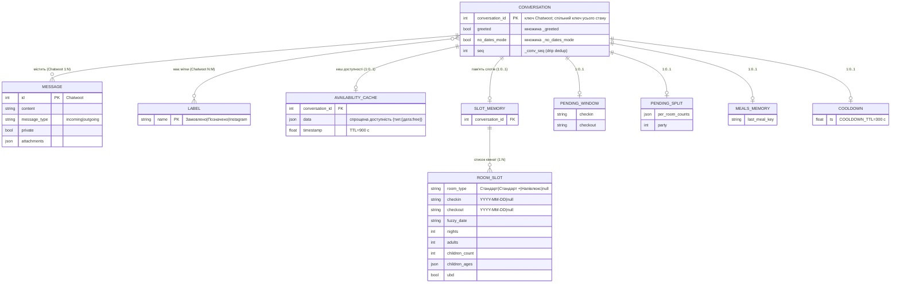
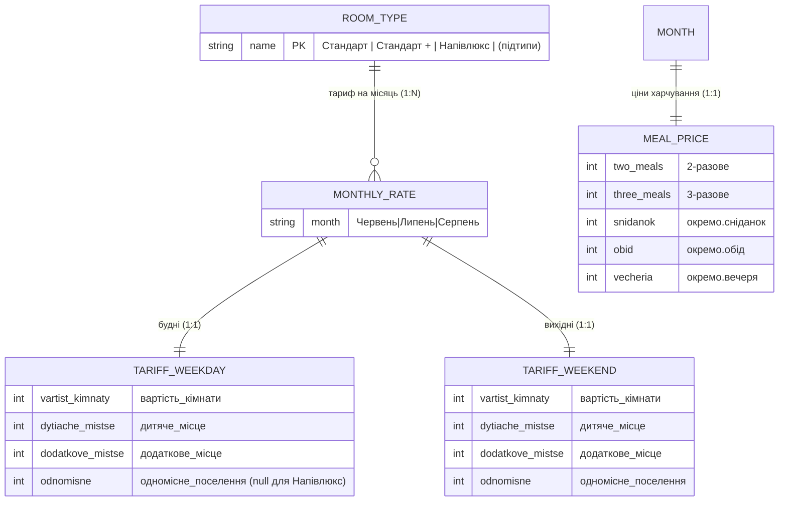
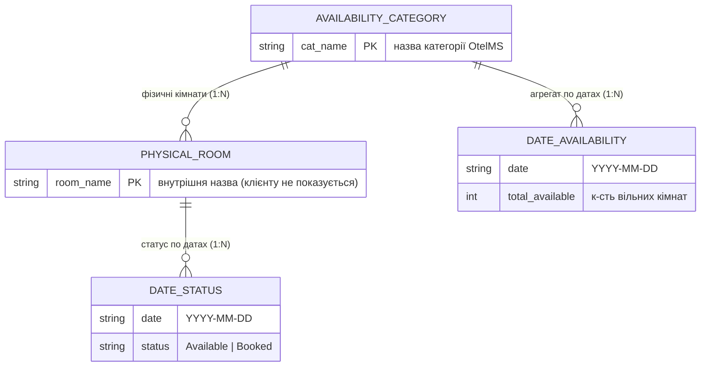

# Підрозділ 3.3 — Проєктування бази даних (PostgreSQL)

> Технічна фактура витягнута ВИКЛЮЧНО з реального коду репозиторію `DM` (гілка
> `main`). Секрети замасковано (`***`). Кожне нетривіальне твердження супроводжене
> посиланням `файл:рядок`. Академічний текст за цією фактурою пише інша модель.

---

## 3.3.0 Головний висновок (читати першим)

**Застосунок бота (`bot-brain`) НЕ проєктує і НЕ має власної реляційної бази
даних.** У репозиторії немає ORM-моделей, міграцій, SQL-DDL, ORM-драйвера чи
підключення до БД з боку бота. Це підтверджено прямим пошуком:

* пошук за `alembic`, `op.create_table`, `declarative_base`, `Column(`,
  `relationship(`, `CREATE TABLE`, `INSERT INTO`, `SELECT … FROM` по `scraper/` —
  **жодного збігу** (усі попередні збіги — це слово «column»/фраза «select … from»
  у прозі коментарів, не код);
* у прод-залежностях (`scraper/requirements.txt`, перелічені у
  [00-overview.md](00-overview.md) §2) **немає** жодного драйвера БД
  (`psycopg`/`asyncpg`/`sqlalchemy`/`sqlite3`-обгортки) — лише `fastapi`,
  `uvicorn`, `playwright`, `beautifulsoup4`, `requests`, `python-dotenv`,
  `google-genai`;
* контейнер бота залежить від `rails`, **не від** `postgres`
  (`scraper/docker-compose.yaml:64-65`; `docker-compose-coolify.yaml:95-96`).

**Єдина PostgreSQL у проєкті — це БД платформи Chatwoot** (стороннього продукту),
а не бота. Її фізична схема (таблиці, стовпці, ключі) визначена міграціями Rails
**усередині Docker-образу `chatwoot/chatwoot:latest`** і **`[не знайдено в
репозиторії]`** — репозиторій `DM` її не містить і не проєктує.

Тому цей підрозділ документує:
1. те, що про PostgreSQL **реально є в репозиторії** — конфіг сервісу Chatwoot-БД
   у compose-файлах та команду її ініціалізації (3.3.1–3.3.2, 3.3.5);
2. **фактичний рівень даних застосунку**, який замінює власну БД: оперативний стан
   у пам'яті процесу, файлова конфігурація та сутності Chatwoot, що читаються через
   REST (3.3.3–3.3.4);
3. **логічну (концептуальну) ER-модель** предметної області в тому вигляді, як її
   представляє застосунок — з явним застереженням, що це НЕ фізична схема
   PostgreSQL (3.3.7–3.3.8).

---

## 3.3.1 Що з PostgreSQL реально присутнє в репозиторії

PostgreSQL згадується лише як **сервіс у стеку Docker Compose** (БД для Chatwoot),
у двох файлах:

| Файл | Роль |
|---|---|
| `scraper/docker-compose.yaml:35-45` | локальний (dev) стек: сервіс `postgres` |
| `docker-compose-coolify.yaml:56-68` | прод-варіант (Coolify): той самий сервіс без публікації порту |

Опис сервісу (локальний compose, `scraper/docker-compose.yaml:35-45`):

| Параметр | Значення | Рядок |
|---|---|---|
| Образ | `pgvector/pgvector:pg16` (PostgreSQL 16 + розширення `pgvector`) | `:36` |
| БД | `POSTGRES_DB=chatwoot` | `:43` |
| Користувач | `POSTGRES_USER=postgres` | `:44` |
| Пароль | `POSTGRES_PASSWORD=***` (замасковано) | `:45` |
| Публікація порту (dev) | `127.0.0.1:5433:5432` — лише loopback хоста | `:38-39` |
| Том даних | `postgres_data:/var/lib/postgresql/data` | `:40-41`, `:68` |

У прод-варіанті (`docker-compose-coolify.yaml:56-68`) БД **не публікується** на хост
(`expose: "5432"`, `:60-61`), пароль береться з env-UI Coolify з fallback на старе
значення: `POSTGRES_PASSWORD=${POSTGRES_PASSWORD:-***}` (`:68`), а зовнішні змінні
підключення Chatwoot до БД (`POSTGRES_HOST=postgres`, `POSTGRES_USERNAME=postgres`,
`POSTGRES_DATABASE=chatwoot`) перелічені як обов'язкові у коментарі
(`docker-compose-coolify.yaml:16`).

> Образ `pgvector/pgvector:pg16` — це PostgreSQL із розширенням `pgvector`
> (векторний пошук). Його використовує Chatwoot; у коді бота вектори не
> застосовуються `[не знайдено в репозиторії — використання pgvector лежить у
> застосунку Chatwoot, поза межами репозиторію DM]`.

---

## 3.3.2 Чия це БД і де її схема

* **Власник БД — Chatwoot** (сервіси `rails` та `sidekiq`, образ
  `chatwoot/chatwoot:latest`), які єдині мають `depends_on: [postgres, redis]`
  (`scraper/docker-compose.yaml:10-12, 25-27`).
* **Бот (`bot-brain`) до PostgreSQL не підключається** — його залежність лише
  `depends_on: rails` (`scraper/docker-compose.yaml:64-65`), а спілкування з
  Chatwoot іде **тільки через REST API** (див. 3.3.6), не через SQL.
* **Фізична схема (таблиці/стовпці/ключі) БД Chatwoot** визначена ActiveRecord-
  міграціями Rails, які поставляються **всередині образу** `chatwoot/chatwoot`.
  У репозиторії `DM` цих міграцій немає → **`[не знайдено в репозиторії]`**. Тому
  повний перелік таблиць Chatwoot (`accounts`, `conversations`, `messages`,
  `contacts`, `labels`/`taggings`, `inboxes` тощо) з цього репозиторію
  задокументувати **неможливо без припущень**; ті сутності, з якими бот реально
  працює через API, наведено у 3.3.4 (г).

---

## 3.3.3 Фактичний рівень даних застосунку (замість власної БД)

Оскільки власної БД немає, «рівень даних» бота складають три носії.

### (а) Оперативний стан у пам'яті процесу (volatile)

Уся пам'ять діалогу — це звичайні Python-`dict`/`set` у процесі FastAPI. Вони
**не персистуються** і повністю скидаються при рестарті `bot-brain`.

| Структура | Тип | Ключ → Значення | Призначення | Рядок |
|---|---|---|---|---|
| `AVAILABILITY_CACHE` | `dict` | `conversation_id` → `(data, timestamp)` | кеш результату скрапінгу доступності, TTL `CACHE_TTL=900` c | `bot_server.py:28-29` |
| `_conv_locks` | `dict` | `conversation_id` → `asyncio.Lock` | серіалізація обробки в межах однієї конверсації | `bot_server.py:312` |
| `_conv_seq` | `dict` | `conversation_id` → `int` | лічильник порядку вхідних (drip-burst dedup) | `bot_server.py:313` |
| `_slot_memory` | `dict` | `conversation_id` → `list[room]` | останні відомі кімнати бронювання (стійкість до втрат екстрактором) | `bot_server.py:314` |
| `_greeted` | `set` | `{conversation_id}` | конверсації, які вже привітано | `bot_server.py:315` |
| `_pending_window` | `dict` | `conversation_id` → `(checkin, checkout)` | перше запропоноване вільне вікно | `bot_server.py:316` |
| `_pending_split` | `dict` | `conversation_id` → `(per-room counts, party)` | запропонований розподіл по кімнатах | `bot_server.py:317` |
| `_meals_memory` | `dict` | `conversation_id` → ключ запиту харчування | анти-повтор відповіді про харчування | `bot_server.py:318` |
| `_no_dates_mode` | `set` | `{conversation_id}` | клієнт заявив, що дат ще не знає | `bot_server.py:319` |
| `_cooldowns` | `dict` | `conversation_id` → `timestamp` | 5-хв «мовчання» після збою LLM (`COOLDOWN_TTL=300`) | `bot_server.py:30, 320` |

**Спільний ключ усіх структур — `conversation_id`** (ідентифікатор конверсації
Chatwoot). Фактично він відіграє роль зовнішнього первинного ключа, навколо якого
організовано весь стан у пам'яті.

Доступ до кешу інкапсульовано у двох функціях:
* `get_hotel_data_cached(conversation_id)` — повертає свіжий кеш або запускає
  скрапер і кладе результат у кеш (`bot_server.py:99-115`);
* `peek_cached_availability(conversation_id)` — читає лише теплий кеш без скрапінгу
  (`bot_server.py:118-129`).

### (б) Файлова конфігурація / база знань (persistent, read-only)

| Носій | Формат | Вміст | Файл |
|---|---|---|---|
| Цінова конфігурація | JSON | тарифи по типах/місяцях/будні-вихідні, правила, місткість, харчування | `scraper/pricing.json` |
| База знань шаблонів | Python-константи | усі клієнтські тексти (FAQ, ціни, редиректи) | `scraper/templates.py` |

`pricing.json` завантажується ціновим рушієм при старті (конфіг
`_DEFAULT_PRICING_PATH`, `pricing_engine.py:79`; див. [03-1-architecture.md](03-1-architecture.md) §3.1.2 D).
Це **конфіг, а не БД**: read-only, без запису під час роботи.

### (в) Системи-джерело істини поза процесом

| Система | Що зберігає | Як бот отримує |
|---|---|---|
| **Chatwoot** (PostgreSQL всередині) | конверсації, повідомлення, мітки, контакти | REST API (3.3.6) |
| **OtelMS** («Шахівниця») | реальний календар броней | Playwright-скрапінг → JSON (3.3.4 б) |

Тобто **систему-джерело істини про діалоги тримає Chatwoot**, а не бот; бот лише
читає/пише через API і кешує похідні дані в пам'яті.

---

## 3.3.4 Логічні структури даних (схеми) — дослівно

Нижче — фактичні форми даних, з якими оперує код. Назви полів наведено **дослівно**.

### (а) `scraper/pricing.json` — цінова конфігурація

Вкладена структура (не таблиці, а деревоподібний JSON-конфіг); ключі —
українською, дослівно з файлу (`pricing.json:1-115`):

```
{
  "правила_готелю": { "діти_0_5_років", "діти_6_11_років", "діти_від_12_років",
                      "військові", "будні_дні", "вихідні_дні" },      // pricing.json:2-9
  "Харчування": { "<Місяць>": { "будні/вихідні": {
                      "2-разове": <int>, "3-разове": <int>,
                      "окремо": { "сніданок", "обід", "вечеря" } } } },// :10-20
  "місткість_номерів": { "<тип>": "<текст правила місткості>" },       // :21-28
  "ціни_по_категоріях": {
      "<тип_номера>": {                                                // :29-113
          "<Місяць>": {
              "будні":   { "вартість_кімнати", "дитяче_місце",
                           "додаткове_місце", "одномісне_поселення" },
              "вихідні": { … ті самі 4 ключі … }
          }
      }
  }
}
```

* **Типи номерів** (ключі `ціни_по_категоріях`, `pricing.json:30,44,58,72,86,100`):
  `Стандарт`, `Стандарт сімейний В+Д`, `Стандарт 4х 2Л + Д`, `Стандарт +`,
  `Стандарт + Сімейний В+Д`, `Напівлюкс`.
* **Місяці** (ключі): `Червень`, `Липень`, `Серпень`.
* **Значення тарифу** (для кожного `будні`/`вихідні`): `вартість_кімнати` (int),
  `дитяче_місце` (int, зазвичай 300), `додаткове_місце` (int),
  `одномісне_поселення` (int або `null` — для `Напівлюкс` завжди `null`,
  `pricing.json:102-111`).

### (б) Availability JSON — вихід скрапера OtelMS

`hotel_scraper.parse_detailed_availability(html)` (`hotel_scraper.py:59-132`)
будує словник із двома рівнями деталізації на кожну **категорію**:

```
{
  "<Назва категорії OtelMS>": {          // hotel_scraper.py:71
      "total_available": { "YYYY-MM-DD": <int вільних>, … },   // агрегат, :80
      "rooms": {
          "<Назва фізичної кімнати>": { "YYYY-MM-DD": "Available" | "Booked", … } // :97-125
      }
  }
}
```

* `total_available` — скільки фізичних кімнат категорії вільні на кожну дату (`:80`).
* `rooms[room][date]` — статус конкретної фізичної кімнати: `"Available"` (`:102`)
  або `"Booked"` (`:125`).

Далі `bot_logic.build_simplified_availability` (`bot_logic.py:49-70`) згортає це до
**спрощеної форми** для цінового гейта, прибираючи чорний список
(`IGNORE_CATEGORIES = ["Колиба","Басейн","Overbooking"]`) і зводячи всі підтипи до
3 публічних категорій:

```
{ "<публічний_тип>": { "YYYY-MM-DD": <free_count int>, … } }   // bot_logic.py:52-70
```

### (в) Слоти екстракції — вихід LLM (не зберігаються в БД)

LLM повертає **виключно JSON** заданої форми; це проміжний слотовий об'єкт, який
живе лише в межах обробки повідомлення (структура — `bot_server.py:162-168`):

```
{
  "topic": "<price_quote|general_price|faq|presentation|group_event|thinking|
             reject_dates|booking_confirm|fuzzy_dates|nearest_dates|greeting|
             barter|unknown>",                                          // :164
  "rooms": [ {                                                          // :165
      "room_type": "Стандарт|Стандарт +|Напівлюкс|null",
      "checkin": "YYYY-MM-DD|null", "checkout": "YYYY-MM-DD|null",
      "fuzzy_date": "<текст|null>", "nights": "<int|null>",
      "adults": <int>, "children_count": <int>,
      "children_ages": [<int>, …], "ubd": <true|false>
  } ],
  "faq_template": "<POOL|PETS|FOOD_PRICES|…|null>",                     // :166
  "meals": { "persons": "<int|null>", "three_meals_days": <int>,
             "two_meals_days": <int>, "breakfast_days": <int>,
             "lunch_days": <int>, "dinner_days": <int> }                // :167
}
```

Об'єкт `room` — центральна доменна сутність бронювання; його останній стан
кешується в `_slot_memory` (3.3.3 а).

### (г) Сутності Chatwoot, які реально читає/пише бот (через REST)

Це **підмножина полів БД Chatwoot**, до яких звертається код бота (повна схема
Chatwoot — `[не знайдено в репозиторії]`):

| Сутність (Chatwoot) | Поля, які використовує бот | Де в коді |
|---|---|---|
| **Conversation** | `id` (= `conversation_id`) | усюди як ключ; webhook `conversation.id`/`conversation_id` (`bot_server.py:901-914`) |
| **Message** | `id` (для сортування), `content`, `message_type` (`incoming`/`outgoing`), `private`, `attachments` | `get_chatwoot_history` `bot_server.py:52-69`; webhook `:901-916` |
| **Label** (мітка конверсації) | назва мітки (рядок): `Замовлено`, `Позначено`, `Instagram` | `get_conversation_labels` `:71-81`, `add_conversation_label` `:83-97` |

---

## 3.3.5 Інструмент міграцій і як вони застосовуються

* **Alembic у проєкті НЕ використовується** — `[не знайдено в репозиторії]` (немає
  `alembic.ini`, каталогу `versions/`, файлів `op.create_table`).
* Міграції стосуються **лише БД Chatwoot** і виконуються **інструментом Rails
  ActiveRecord**, що вбудований в образ `chatwoot/chatwoot:latest`.
* **Ініціалізація «чистої» БД** (з `project_spec.md:737-738`):
  ```
  bundle exec rails db:chatwoot_prepare
  ```
  запускається **всередині контейнера `rails`** (через термінал Coolify), після
  чого перезапускаються `rails`/`sidekiq`; команда ідемпотентна.
* Поточна фаза розгортання — «Test-Drive / Beta»: ініціалізація прод-БД і
  застосування прод-`CHATWOOT_TOKEN` (`project_spec.md:740-743`).

> Тобто у репозиторії `DM` **немає власного механізму міграцій** — керування схемою
> повністю делеговано платформі Chatwoot.

---

## 3.3.6 Як застосунок працює з даними (ORM чи сирі запити; точки доступу)

**Ні ORM, ні сирих SQL-запитів бот не використовує.** Доступ до даних — три канали:

| Канал | Механізм | Ключові точки доступу | Рядок |
|---|---|---|---|
| **Chatwoot (діалоги/мітки)** | HTTP REST (`requests`), заголовок `api_access_token` | `send_chatwoot_message` (POST), `get_chatwoot_history` (GET), `get_conversation_labels` (GET), `add_conversation_label` (POST) | `bot_server.py:32-97` |
| **Оперативний стан** | in-memory `dict`/`set` | `get_hotel_data_cached`, `peek_cached_availability`, `_slot_memory`, `_pending_*` | `bot_server.py:99-129, 312-320` |
| **Конфіг цін** | читання JSON-файлу | завантаження `pricing.json` у `PricingEngine` | `pricing_engine.py:79` |

Наслідки такої архітектури (підтверджено кодом):
* **Немає транзакцій, схем, індексів, зовнішніх ключів на боці бота** — усе
  тримається на `conversation_id` як логічному ключі в пам'яті.
* **Стан не персистується**: рестарт `bot-brain` очищає кеш і пам'ять діалогу
  ([03-1-architecture.md](03-1-architecture.md) §3.1.3: «при рестарті `bot-brain`
  кеш і пам'ять діалогу скидаються»). Довготривала історія доступна лише тому, що
  її зберігає **Chatwoot** і бот щоразу перечитує її через `get_chatwoot_history`.

---

## 3.3.7 Текстовий опис ER-моделі (концептуальна / логічна)

> ⚠ Це **логічна** ER-модель предметної області в тому вигляді, як її представляє
> застосунок (пам'ять процесу + JSON-конфіг + сутності Chatwoot, доступні через
> API). Це **НЕ фізична схема таблиць PostgreSQL** — власної реляційної БД бот не
> має (3.3.0), а фізична схема Chatwoot у репозиторії відсутня (3.3.2).

Центральна сутність — **Conversation** (конверсація Chatwoot), ідентифікована
`conversation_id`. Навколо неї групуються:

* **Conversation → Message** — `1:N`: одна конверсація містить багато повідомлень
  (Chatwoot; бот читає їх через `get_chatwoot_history`, `bot_server.py:52-69`).
* **Conversation → Label** — `N:M` (у Chatwoot реалізовано через мітки/tagging):
  конверсація має набір міток, та сама мітка (`Замовлено`, `Позначено`,
  `Instagram`) застосовна до багатьох конверсацій (`bot_server.py:71-97`).
* **Conversation → AvailabilityCacheEntry** — `1:0..1`: на конверсацію припадає
  щонайбільше один запис кешу доступності (`AVAILABILITY_CACHE`, `bot_server.py:28`).
* **Conversation → SlotMemory** — `1:0..1`: останній відомий набір кімнат
  бронювання (`_slot_memory`, `bot_server.py:314`).
* **SlotMemory → RoomSlot** — `1:N`: пам'ять слотів містить список об'єктів-кімнат
  (структура `rooms[]`, `bot_server.py:165`).
* **Conversation → PendingWindow / PendingSplit / MealsMemory / Cooldown** —
  кожне `1:0..1`, ключ `conversation_id` (`bot_server.py:316-320`).

Конфігураційна (довідкова) частина, з `pricing.json`:

* **RoomType → MonthlyRate** — `1:N`: тип номера має тариф на кожен місяць
  (`ціни_по_категоріях[тип][місяць]`, `pricing.json:29-113`).
* **MonthlyRate → TariffLine** — `1:2`: кожен місяць має два тарифні рядки —
  `будні` і `вихідні`, кожен із полями `вартість_кімнати`, `дитяче_місце`,
  `додаткове_місце`, `одномісне_поселення` (`pricing.json:32-33` тощо).
* **Month → MealPrice** — `1:1`: на місяць — набір цін харчування
  (`Харчування[місяць]`, `pricing.json:10-20`).

Похідна (скрапована) частина, з availability JSON:

* **AvailabilityCategory → PhysicalRoom** — `1:N`: категорія містить кілька
  фізичних кімнат (`rooms{}`, `hotel_scraper.py:97`).
* **PhysicalRoom → DateStatus** — `1:N`: у кімнати — статус (`Available`/`Booked`)
  на кожну дату (`hotel_scraper.py:102-125`).
* **AvailabilityCategory → DateAvailability** — `1:N`: агрегат `total_available`
  (вільних на дату), `hotel_scraper.py:80`.

Зв'язок конфігу зі станом: **RoomSlot.room_type** посилається на публічний
**RoomType** (`Стандарт` / `Стандарт +` / `Напівлюкс`), а гейт доступності зіставляє
його з `AvailabilityCategory` після згортання підтипів
(`build_simplified_availability`, `bot_logic.py:49-70`).

---

## 3.3.8 Чернетка ER-діаграми (Mermaid)

> Формат чорновий (концептуальна модель, не фізична схема). Дослівні (українські)
> імена полів — у таблицях 3.3.4; у діаграмі частину імен подано ASCII-токенами, а
> дослівне значення винесено в лапки-коментар, щоб Mermaid коректно парсив.

### (а) Логічна модель стану діалогу (пам'ять процесу + Chatwoot)



### (б) Довідкова модель конфігу цін (`pricing.json`)



### (в) Похідна модель доступності (вихід скрапера)



---

## 3.3.9 Зауваги про повноту

* **Фізична схема PostgreSQL бота — відсутня**, бо бот не має власної БД (3.3.0);
  усі попередні спроби знайти ORM/DDL/міграції дали порожній результат.
* **Фізична схема БД Chatwoot — `[не знайдено в репозиторії]`**: вона в образі
  `chatwoot/chatwoot:latest`, а не в `DM`. Перелічити її таблиці/стовпці/ключі з
  цього репозиторію можна лише як `[припущення — потребує перевірки]`, тому в
  3.3.4 (г) наведено **тільки** ті поля, до яких є фактичне звернення в коді.
* **Оперативний стан бота — енергозалежний** (`dict`/`set` у пам'яті); він не є
  «базою даних» у строгому сенсі — без персистентності, транзакцій та цілісності;
  джерело істини про діалоги — Chatwoot.
* Використання розширення `pgvector` (з образу БД) у коді бота не виявлено —
  `[не знайдено в репозиторії]`.

*Документ відображає фактичний стан роботи з даними у репозиторії; усі шляхи, імена
полів і значення конфігів наведено дослівно з файлів.*
